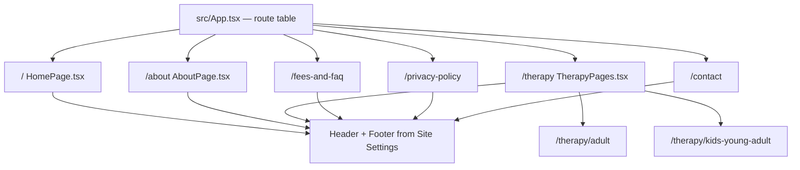
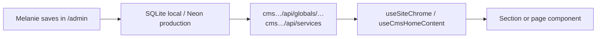

# Website structure map

Think of this as **browser DevTools for the practice**: hover a part of the site, then see which file paints it and which CMS screen Melanie edits.

- **Left / visitor** = what is on the page  
- **Middle / engineer** = the React (or CSS) that draws it  
- **Right / planner** = Payload `/admin` (Melanie)

Open this file in Cursor preview to render the diagrams.

---

## 1. Inspector pairs (visual → code → CMS)

```mermaid
flowchart LR
  subgraph VISITOR["What you see"]
    Pal["Colour palette<br/>terracotta / cream / type"]
    Logo["Logo"]
    Nav["Main menu + Let's Talk"]
    Hero["Hero"]
    Intro["Introduction"]
    Services["How we help cards"]
    Meet["Meet your therapist"]
    Founder["Practice founder"]
    Location["Surrey / online line"]
    Quote["Testimonial"]
    Cta["Bottom CTA"]
    Popup["Newsletter popup"]
    Foot["Footer + social"]
    About["About Me page"]
    Therapy["Therapy / Adult / Kids"]
    Fees["Fees and FAQ"]
    Privacy["Privacy Policy"]
    Contact["Contact form"]
    Photos["Photos and files"]
    Notes["Planner notes inbox"]
  end

  subgraph ENGINEER["Code that draws it"]
    Css["src/index.css"]
    LogoF["src/components/ui/Logo.tsx"]
    Head["src/components/sections/Header.tsx"]
    HeroF["src/components/sections/Hero.tsx"]
    IntroF["src/components/sections/Introduction.tsx"]
    SvcF["src/components/sections/ServicesGrid.tsx"]
    MeetF["src/components/sections/MeetYourTherapists.tsx"]
    FoundF["src/components/sections/PracticeManager.tsx"]
    LocF["src/components/sections/LocationMap.tsx"]
    QuoteF["src/components/sections/Testimonial.tsx"]
    CtaF["src/components/sections/Cta.tsx"]
    PopF["src/components/sections/NewsletterPopup.tsx"]
    FootF["src/components/sections/Footer.tsx"]
    AboutF["src/pages/AboutPage.tsx"]
    TherF["src/pages/TherapyPages.tsx"]
    FeesF["src/pages/FeesFAQPage.tsx"]
    PrivF["src/pages/PrivacyPolicyPage.tsx"]
    ContF["src/pages/ContactPage.tsx"]
    FormF["src/components/ConsultationForm.tsx"]
    Routes["src/App.tsx"]
    Bridge["src/hooks/useCmsHomeContent.ts<br/>src/hooks/useSiteChrome.ts"]
  end

  subgraph PLANNER["Melanie edits in /admin"]
    Theme["Not in CMS — Aaron changes CSS"]
    SiteG["Website → Menu, footer and social"]
    HomeG["Website → Homepage content"]
    SvcC["Website → Services"]
    AboutG["Website → About Me"]
    TherG["Website → Therapy pages"]
    FeesG["Website → Fees and FAQ"]
    PrivG["Website → Privacy Policy"]
    ContG["Website → Contact page"]
    MediaC["Website → Photos and files"]
    PlanC["Planner → Planner notes"]
  end

  Pal --> Css --> Theme
  Logo --> LogoF --> Theme
  Nav --> Head --> SiteG
  Hero --> HeroF --> HomeG
  Intro --> IntroF --> HomeG
  Services --> SvcF --> SvcC
  Meet --> MeetF --> AboutG
  Founder --> FoundF --> HomeG
  Location --> LocF --> HomeG
  Quote --> QuoteF --> HomeG
  Cta --> CtaF --> HomeG
  Popup --> PopF --> SiteG
  Foot --> FootF --> SiteG
  About --> AboutF --> AboutG
  Therapy --> TherF --> TherG
  Fees --> FeesF --> FeesG
  Privacy --> PrivF --> PrivG
  Contact --> ContF --> ContG
  Contact --> FormF
  Photos --> MediaC
  Notes --> PlanC
  Head --> Bridge
  HeroF --> Bridge
  SvcF --> Bridge
  AboutF --> Bridge
  TherF --> Bridge
  Routes -.-> Head
```

---

## 2. Page tree (routes)

Home page **sections in order** (top → bottom):

1. Header  
2. Hero  
3. Introduction  
4. Services grid  
5. Meet your therapist  
6. Practice founder  
7. Location  
8. Testimonial  
9. CTA  
10. Footer  
11. Newsletter popup  

---

## 3. How copy reaches the page

If the API is down, hooks fall back to the default strings in `src/lib/cms/homeContent.ts` and `src/lib/cms/siteContent.ts`. Those files are **not** for Melanie to edit.

---

## Quick lookup

| You see | Engineer file | Planner screen in `/admin` |
|--|--|--|
| Terracotta, cream, type | `src/index.css` | — (Aaron) |
| Logo | `src/components/ui/Logo.tsx` | — (Aaron) |
| Menu, Let's Talk, footer, social, popup | `Header.tsx`, `Footer.tsx`, `NewsletterPopup.tsx` | **Menu, footer & social** |
| Hero, intro, CTA, quote, location, founder blurb | matching `sections/*.tsx` | **Homepage content** |
| Service cards | `ServicesGrid.tsx` | **Services** |
| About Me page + homepage therapist card | `AboutPage.tsx`, `MeetYourTherapists.tsx` | **About Me** |
| Therapy overview / Adult / Kids | `TherapyPages.tsx` | **Therapy pages** |
| Fees, privacy, contact headings | matching `pages/*.tsx` | matching Website globals |
| Photos | `` via `mediaUrl()` | **Photos & files** |
| “Please add Instagram / a new page” | — | **Planner notes** |
| Login, passkey, authenticator | `cms/src/admin/*` | Accounts (Aaron) |

Editor URL: `http://localhost:3000/admin` locally, `https://cms.thecalhounpractice.com/admin` in production.
